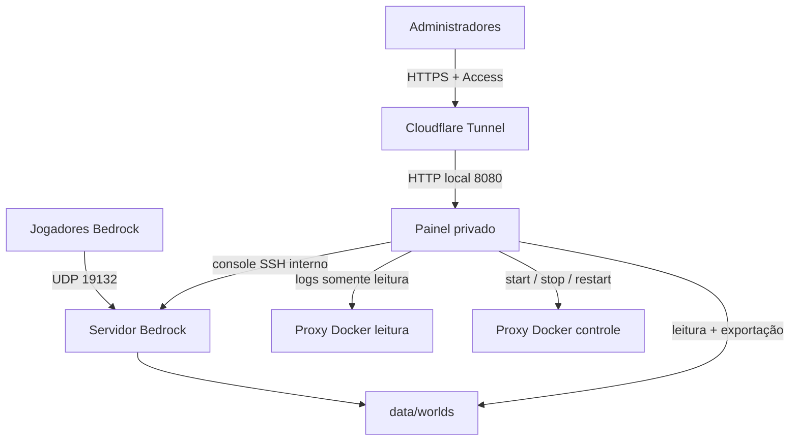

# Minecraft Bedrock Hub

Servidor Minecraft Bedrock autocontido para Docker, acompanhado por um painel
administrativo privado. O projeto foi preparado para rodar em um computador
Windows/Linux ou em uma VPS; o GitHub guarda e versiona a configuração, mas
**não hospeda o processo do Minecraft**.

## O que está pronto

- Bedrock Dedicated Server estável, com verificação da versão `LATEST` em cada
  inicialização;
- reinício diário configurável para buscar novas versões automaticamente;
- mundo persistente em `data/`, fora do Git;
- nenhum addon, behavior pack ou resource pack instalado por padrão;
- pacotes locais, texturas, skins personalizadas e recursos visuais dos clientes
  não são bloqueados pelo servidor;
- painel responsivo para ligar, reiniciar e desligar com salvamento seguro;
- console ao vivo e envio de comandos Bedrock;
- tamanho, quantidade de arquivos e data de gravação do mundo;
- download consistente do mundo no formato `.mcworld`;
- login por token, rate limit, cookies HttpOnly e proteção de origem;
- painel publicado somente em `127.0.0.1`, pronto para Cloudflare Access/Tunnel;
- socket Docker protegido por dois proxies de permissões mínimas;
- instaladores e diagnóstico para Windows PowerShell e Linux/macOS;
- validação automática pelo GitHub Actions e atualizações pelo Dependabot.

## Arquitetura



O tráfego do jogo e o do painel são diferentes. O painel usa HTTP/HTTPS. O
Bedrock usa UDP e precisa de uma solução própria descrita em
[Rede e acesso dos jogadores](docs/NETWORK.md).

## Instalação rápida no Windows

1. Instale Git e Docker Desktop com WSL 2.
2. Clone este repositório e entre na pasta.
3. Abra o PowerShell comum e execute:

   ```powershell
   Set-ExecutionPolicy -Scope Process Bypass
   .\scripts\setup.ps1
   ```

4. Leia a EULA indicada pelo instalador e digite `ACEITO` somente se concordar.
5. Abra `http://127.0.0.1:8080`.
6. Copie `PANEL_ADMIN_TOKEN` do arquivo `.env` e use-o no login.

O guia completo está em [Instalação no Windows](docs/SETUP-WINDOWS.md).

## Instalação rápida no Linux

Com Docker Engine, Compose e Git instalados:

```bash
git clone URL-DESTE-REPOSITORIO minecraft-bedrock-hub
cd minecraft-bedrock-hub
chmod +x scripts/*.sh
./scripts/setup.sh
```

Depois abra `http://127.0.0.1:8080` na própria máquina ou configure o túnel.

## Configuração

As opções ficam no arquivo local `.env`, criado pelo instalador e ignorado pelo
Git. Pare de editar quando não souber o efeito de uma propriedade e reinicie os
serviços depois da mudança:

```bash
docker compose up -d
```

| Variável | Padrão | Função |
|---|---:|---|
| `SERVER_NAME` | Servidor Bedrock | Nome exibido no jogo e no painel |
| `LEVEL_NAME` | Mundo Principal | Nome da pasta persistente do mundo |
| `GAMEMODE` | survival | `survival`, `creative` ou `adventure` |
| `DIFFICULTY` | normal | `peaceful`, `easy`, `normal` ou `hard` |
| `MAX_PLAYERS` | 10 | Limite de jogadores simultâneos |
| `VIEW_DISTANCE` | 32 | Distância de visualização enviada pelo servidor |
| `ALLOW_CHEATS` | false | Habilita comandos que alteram o jogo |
| `ALLOW_LIST` | false | Restringe entrada à lista autorizada |
| `ALLOW_LIST_USERS` | vazio | Gamertags/XUIDs separados por vírgula |
| `OPS` | vazio | Operadores por gamertag/XUID, separados por vírgula |
| `MINECRAFT_PORT` | 19132 | Porta UDP publicada no computador |
| `PANEL_PORT` | 8080 | Porta local do painel |
| `AUTO_UPDATE_TIME` | 05:00 | Horário diário de reinício; vazio desativa |
| `TZ` | America/Bahia | Fuso dos logs e do reinício automático |

Não altere `CONSOLE_PASSWORD` com o servidor em execução sem recriar os
contêineres. Nunca publique os dois segredos presentes no `.env`.

## Texturas, shaders e addons

O servidor nasce sem packs adicionais. `TEXTUREPACK_REQUIRED=false` evita
forçar um pacote de servidor e `DISABLE_CUSTOM_SKINS=false` mantém skins
personalizadas permitidas. Texturas e recursos exclusivamente locais continuam
sendo responsabilidade de cada cliente.

Shaders no Bedrock dependem da edição, plataforma, versão do jogo e pipeline de
renderização do cliente. Portanto, o servidor não bloqueia esses recursos, mas
também não consegue tornar compatível um shader que o próprio cliente atual não
suporte. Nenhum shader é instalado ou distribuído por este projeto.

## Operação normal

- Painel: `http://127.0.0.1:8080`
- Jogo na rede local: `IP-DO-PC:19132`
- Diagnóstico: `scripts/doctor.ps1` ou `./scripts/doctor.sh`
- Atualização manual: `scripts/update.ps1` ou `./scripts/update.sh`
- Logs de emergência: `docker compose logs -f bedrock panel`
- Parar todo o conjunto: `docker compose down`
- Voltar a ligar: `docker compose up -d`

`docker compose down` preserva `data/`. Não use `down -v` e não apague a pasta
`data`, pois ela contém o mundo. Veja [Operação e recuperação](docs/OPERATIONS.md).

## Publicação segura do painel

Use [Cloudflare Tunnel e Access](docs/CLOUDFLARE.md). O túnel aponta para
`http://127.0.0.1:8080`, e o Access define exatamente quais e-mails podem abrir
a página. O token do painel permanece como uma segunda barreira.

## Créditos e licenças

O código deste repositório usa a licença MIT. Minecraft e o Bedrock Dedicated
Server pertencem à Mojang/Microsoft e permanecem sujeitos à EULA e aos termos
oficiais. A imagem do servidor é fornecida pelo projeto
[`itzg/docker-minecraft-bedrock-server`](https://github.com/itzg/docker-minecraft-bedrock-server),
que baixa o binário do servidor a partir dos serviços do Minecraft durante a
inicialização.
